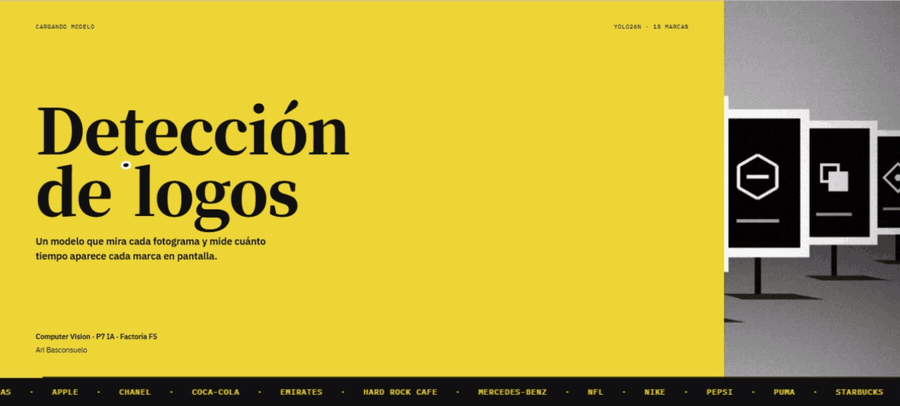
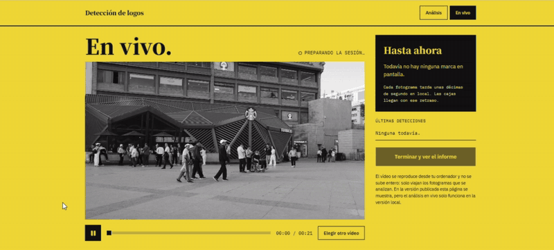
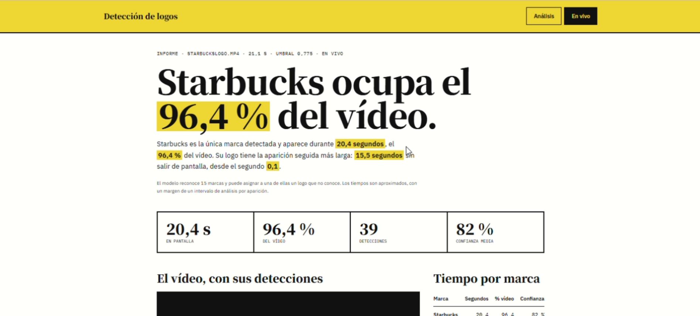
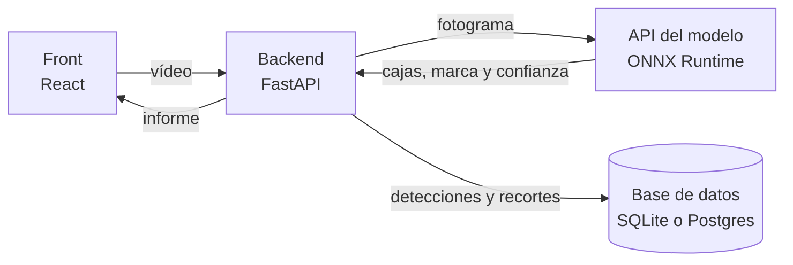
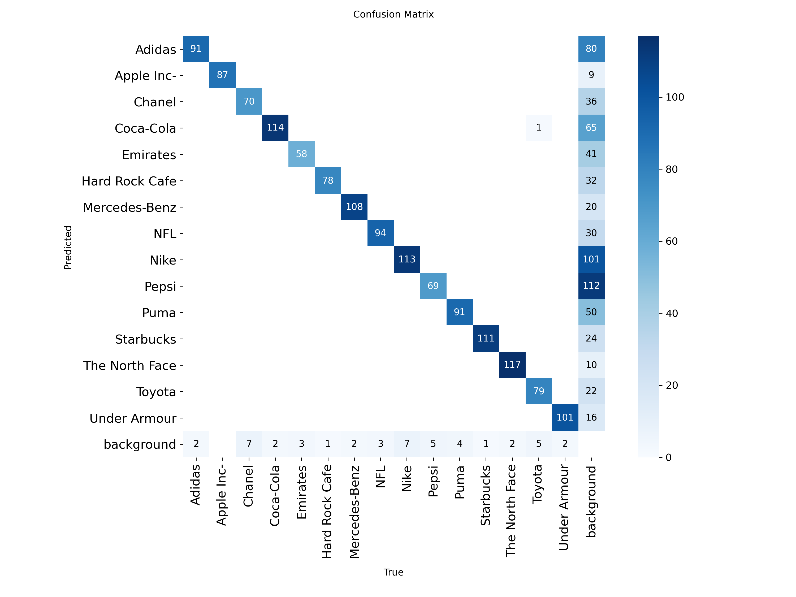
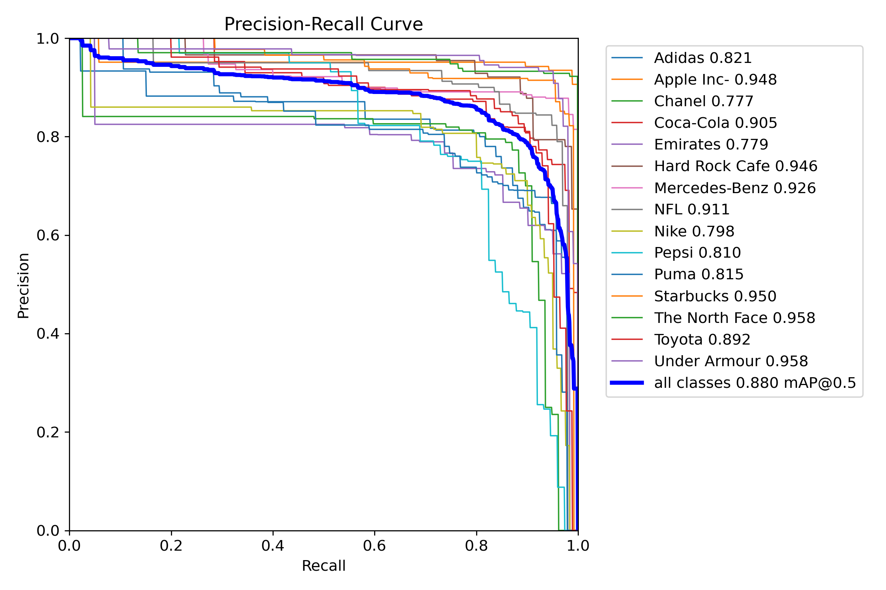
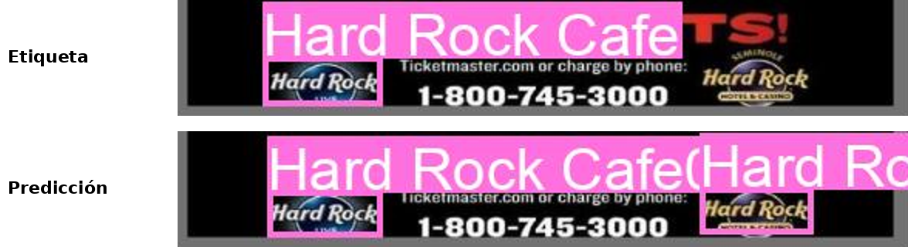

# Detección de logos en vídeo

**Un modelo YOLO que reconoce 15 marcas en vídeo, mide cuánto tiempo aparece cada una y guarda cada detección en una base de datos.**



[**Probar la aplicación**](URL_DE_LA_WEB) · [Informe técnico completo](docs/informe.md) · [Ari Basconsuelo en LinkedIn](https://www.linkedin.com/in/arielbasconsuelo/)

      

## El proyecto

El *briefing* lo proporciona [Factoría F5](https://factoriaf5.org) dentro de su formación en Inteligencia Artificial (promoción P7, Madrid). Plantea el caso de una agencia de publicidad que quiere comprobar cuánto tiempo aparecen en pantalla los logos de las marcas que representa, para decidir dónde dirigir sus esfuerzos.

El sistema tiene que analizar un vídeo, detectar las marcas, calcular su tiempo de aparición y el porcentaje que suponen sobre la duración total, y guardar las detecciones en una base de datos. El procesado no necesita ser en tiempo real.

**Estado.** Prueba de concepto terminada y desplegada. El modelo, la API, el backend, el front y la versión con Docker funcionan. Las limitaciones del modelo están medidas y documentadas más abajo.

## Demo



La aplicación tiene dos modos.

- **Informe.** Se sube un vídeo, el backend analiza un fotograma por segundo y al terminar muestra el tiempo y el porcentaje por marca, un texto redactado a partir de los datos, el vídeo con las cajas sincronizadas y la galería de recortes.
- **En vivo.** El vídeo se reproduce en el navegador sin subirse, y las cajas aparecen sobre él mientras se analiza. Solo funciona en la versión local, porque en el plan gratuito de la nube cada fotograma tarda de 3 a 4 segundos.



## Resultados

Evaluación del modelo final en la partición de test, que el modelo no vio durante el entrenamiento.

| Métrica | Valor |
| --- | --- |
| mAP50 | **0,891** |
| mAP50-95 | **0,730** |
| Precisión en validación | 0,807 |
| Recall en validación | 0,890 |

Por marca, las más fuertes en mAP50-95 son The North Face (0,832), Starbucks (0,817) y Hard Rock Cafe (0,808). La más débil es Pepsi (0,480).

Estas cifras se miden con imágenes del mismo dataset. Fuera de él, el modelo falla bastante más, como se explica en [Limitaciones](#limitaciones).

## Cómo funciona



1. **El front** sube el vídeo y muestra el progreso, las cajas y el informe. Solo habla con el backend.
2. **El backend** comprueba el archivo, extrae un fotograma por segundo, lo reduce a 640 píxeles y lo envía a la API del modelo. Guarda cada detección con su segundo, su marca, su confianza, su caja y un recorte del logo. Al terminar calcula el informe y borra el vídeo.
3. **La API del modelo** recibe una imagen y devuelve las detecciones de `best.onnx`. Está protegida con una clave en la cabecera `X-API-Key`.

El texto del informe se genera con reglas y plantillas a partir de los datos, sin modelo de lenguaje, siguiendo la técnica de generación de lenguaje natural a partir de datos (Reiter y Dale, 2000). Cada cifra del texto sale directamente de la base de datos.

## El modelo

| | |
| --- | --- |
| **Arquitectura** | YOLO26n de Ultralytics, unos 2,4 millones de parámetros |
| **Entrenamiento** | Ajuste fino (*fine-tuning*) desde los pesos preentrenados en COCO, 100 épocas en una GPU T4 de Google Colab |
| **Datos** | [Logo Brand v2](https://universe.roboflow.com/aitesting-9dz7l/logo-brand/dataset/2) de Roboflow Universe, 9.639 fotografías reales con 15 marcas, divididas en 75 % train, 15 % valid y 10 % test |
| **Preprocesado** | Orientación automática y redimensionado a 640 × 640. Aumentos de datos de Ultralytics durante el entrenamiento (mosaico, volteo horizontal, tono, brillo y escala) |
| **Búsqueda de hiperparámetros** | Algoritmo genético de Ultralytics (`model.tune`), 12 iteraciones. La mejor combinación fue la de los valores por defecto |
| **Umbral de confianza** | 0,775, el máximo de la curva F1 en validación |
| **Formato de uso** | Exportado a ONNX y servido con ONNX Runtime, sin PyTorch |

**Marcas.** Adidas, Apple, Chanel, Coca-Cola, Emirates, Hard Rock Cafe, Mercedes-Benz, NFL, Nike, Pepsi, Puma, Starbucks, The North Face, Toyota y Under Armour.

**Uso previsto.** Medir el tiempo de aparición de esas 15 marcas en vídeos, como prueba de concepto formativa.

**Fuera de alcance.** Marcas que no están en la lista, uso comercial y decisiones que dependan de cifras exactas al segundo.

<table>
<tr>
<td width="50%"></td>
<td width="50%"></td>
</tr>
<tr>
<td>Matriz de confusión en validación, con un umbral de 0,25. El modelo casi no confunde una marca con otra (1 caso sobre 1.428 logos). Su error está en separar logo y fondo.</td>
<td>Curva de precisión y recall en validación. Chanel, Emirates y Nike son las marcas con el AP50 más bajo.</td>
</tr>
</table>

## Limitaciones

Probé el modelo fuera del dataset, con un vídeo de una avenida comercial y con 37 fotografías reales de fachadas, coches y aviones. Encontré tres causas de error.

1. **Conjunto cerrado.** El modelo solo conoce 15 clases y asigna cualquier logo a la más parecida. En el vídeo de la avenida leyó un Volkswagen como Toyota durante 5 segundos con una confianza de hasta 0,86.
2. **Variantes ausentes.** No reconoce formas del logo que no vio al entrenar, como Adidas escrito sin el símbolo.
3. **Diferencia de dominio.** Muchas marcas se aprendieron sobre todo en ropa deportiva. En fachadas, coches o aviones el rendimiento baja, y casi no detecta Emirates en aviones.

Además, el dataset tiene etiquetas incompletas. En una revisión manual de 48 imágenes de validación, entre 7 y 8 de las 11 detecciones sin etiqueta eran logos reales. En este ejemplo, el dataset solo marca el logo de la izquierda y el modelo encuentra también el de la derecha.



Valoré reentrenar con FlickrLogos-32 y LogoDet-3K, pero solo cubrían 5 y 9 de las 15 marcas, y ninguna de las dos que más fallan. El análisis completo está en el [informe técnico](docs/informe.md#pruebas-fuera-del-dataset).

**Líneas futuras.** Etiquetar escenas reales de las marcas más débiles, añadir una clase para logos desconocidos y explorar arquitecturas en dos etapas (Tüzkö et al., 2018) o de vocabulario abierto (Cheng et al., 2024), que permiten añadir marcas sin reentrenar.

## Probarlo

**En la web.** [Abrir la aplicación](URL_DE_LA_WEB). El servicio gratuito se duerme tras 15 minutos sin uso, así que la primera carga puede tardar alrededor de un minuto.

**En local con Docker.** Hace falta [Docker Desktop](https://www.docker.com/products/docker-desktop/).

```bash
git clone https://github.com/arinbasco/logo-detection-cv.git
cd logo-detection-cv
cp .env.example .env
```

* `git clone` descarga el repositorio y `cd` entra en su carpeta.
* `cp .env.example .env` crea el archivo de variables a partir de la plantilla.

Abre `.env` y escribe la misma clave en `API_KEY` y en `MODEL_API_KEY`. Puedes generar una con este comando.

```bash
python -c "import secrets; print(secrets.token_urlsafe(32))"
```

* Genera una clave aleatoria segura de 32 bytes.

Después arranca la aplicación.

```bash
docker compose up -d --wait
```

* `docker compose up` construye y arranca la API del modelo, el backend y el front.
* `-d` los deja en segundo plano y `--wait` espera a que los tres estén listos.

La aplicación queda en `http://localhost:5173`, con los dos modos activos. Para pararla, `docker compose down`.

**Solo el modelo.** Los scripts de `scripts/` prueban el modelo sin la aplicación.

```bash
python scripts/video_en_vivo.py "ruta/al/video.mp4" --conf 0.775 --cada 1
```

* Reproduce el vídeo con las detecciones dibujadas encima y muestra al final un resumen por marca.
* `--conf` fija el umbral de confianza y `--cada` los segundos de vídeo entre dos análisis.

## Estructura del repositorio

```text
api/            API del modelo (FastAPI y ONNX Runtime) con best.onnx
backend/        Análisis de vídeo, base de datos, informe y tests
front/          Aplicación web en React
notebooks/      Notebook de entrenamiento en Google Colab
scripts/        Pruebas del modelo con vídeos e imágenes
docs/           Informe técnico e imágenes del README
docker-compose.yml
.env.example
```

## Tecnologías

| Área | Herramientas |
| --- | --- |
| Datos y entrenamiento | [Roboflow](https://roboflow.com), [Ultralytics](https://github.com/ultralytics/ultralytics), Google Colab |
| Inferencia | [ONNX Runtime](https://github.com/microsoft/onnxruntime), OpenCV |
| API y backend | [FastAPI](https://github.com/fastapi/fastapi), SQLAlchemy, Alembic, pytest |
| Front | React, Vite, TypeScript, Tailwind CSS |
| Despliegue | Docker Compose, Render |

## Autoría

Proyecto individual de **Ari Basconsuelo**, desarrollado en la formación en Inteligencia Artificial de Factoría F5 en Madrid. Abarca todo el ciclo, desde la elección de los datos y el entrenamiento del modelo hasta la API, el backend, el front y el despliegue.

[LinkedIn](https://www.linkedin.com/in/arielbasconsuelo/)

## Licencia

El código de este repositorio se publica con licencia [AGPL-3.0](LICENSE), la misma que usa Ultralytics para sus modelos YOLO y para los modelos entrenados con ellos. El dataset Logo Brand v2 pertenece a sus autores y su página en Roboflow Universe no indica licencia.

## Referencias

- Cheng, T. et al. (2024). [YOLO-World. Real-Time Open-Vocabulary Object Detection](https://openaccess.thecvf.com/content/CVPR2024/html/Cheng_YOLO-World_Real-Time_Open-Vocabulary_Object_Detection_CVPR_2024_paper.html). CVPR 2024.
- Reiter, E. y Dale, R. (2000). *Building Natural Language Generation Systems*. Cambridge University Press.
- Tüzkö, A. et al. (2018). [Open Set Logo Detection and Retrieval](https://arxiv.org/abs/1710.10891). VISAPP 2018.
- Wang, J. et al. (2020). [LogoDet-3K. A Large-Scale Image Dataset for Logo Detection](https://arxiv.org/abs/2008.05359). arXiv 2008.05359.
- Ultralytics. [Hyperparameter Tuning](https://docs.ultralytics.com/guides/hyperparameter-tuning) y [License](https://ultralytics.com/license).
